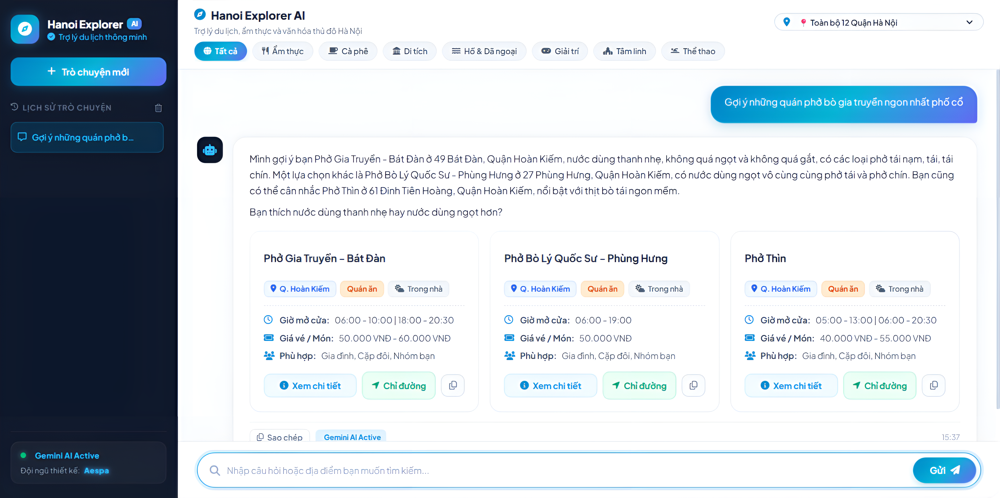
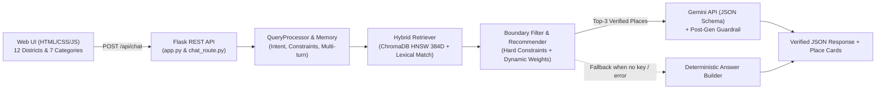

# Hanoi Explorer AI — Trợ lý Tìm kiếm & Tư vấn Địa điểm Hà Nội (Modular RAG)

[](https://hanoi-explorer-ai.onrender.com/)
[](https://www.python.org/)
[](#đánh-giá-thực-nghiệm--kiểm-thử)
[-111827?style=for-the-badge&logo=github)](https://github.com/Winter101006)

**Hanoi Explorer AI** là hệ thống chatbot tư vấn địa điểm ẩm thực, cà phê, di tích lịch sử, không gian tâm linh, điểm dạo chơi ngoài trời, giải trí và thể thao tại **12 quận nội thành Hà Nội** bằng tiếng Việt tự nhiên.

Dự án được thiết kế và xây dựng hoàn chỉnh **End-to-End** bởi **Phạm Ngọc Huân (`@Winter101006`)** theo kiến trúc **Modular RAG (Retrieval-Augmented Generation)** kết hợp truy xuất vector đa ngôn ngữ trên **ChromaDB**, hiểu truy vấn tiếng Việt tất định, xếp hạng đa tiêu chí thích ứng, sinh phản hồi có kiểm chứng qua **Google Gemini API** (kèm cơ chế fallback offline), và đóng gói **Docker Multi-stage ONNX INT8** chạy dưới ngưỡng **260 MB RAM** trên Render Free Tier.

> **Trải nghiệm trực tuyến (Live Demo):** https://hanoi-explorer-ai.onrender.com/  
> *(Lưu ý: Máy chủ Render gói miễn phí có thể mất 30–50 giây để khởi động lại ở lần truy cập đầu tiên sau thời gian nghỉ).*



---

## Điểm nhấn kỹ thuật (Engineering Highlights)

- **Data Engineering End-to-End (1.691 địa điểm chuẩn hóa 14 trường):**
  - Tự xây dựng 2 pipeline thu thập dữ liệu bằng **Selenium + BeautifulSoup4** từ 323 URL công khai (`crawler_1`: 1.375 quán ăn & cà phê; `crawler_2`: 317 điểm tham quan, di tích & vui chơi).
  - Hợp nhất, khử trùng lặp, chuẩn hóa Unicode NFC, ánh xạ 7 mã danh mục (`an-uong`, `ca-phe`, `tam-linh`, `di-tich`, `ngoai-troi`, `giai-tri`, `the-thao`), gắn cờ chất lượng dữ liệu (`address_precision`, `category_conflict`, `coordinates_verified=False`) và chuẩn hóa giá tiền trong `preprocess.py` & `data_loader.py`.
- **Kiến trúc Modular RAG 4 tầng kiểm soát chống ảo giác:**
  1. **Deterministic Vietnamese NLU (`QueryProcessor` & `menu.py`):** Phân tích đồng thời ý định, 12 quận/địa danh, ngân sách chặt (*"dưới 50k"*), món ăn mở kèm mẫu phủ định (*"ngừng bán"*), khử nhiễu tên phố (*"Chùa Láng"* ≠ tâm linh), nhận diện truy vấn mơ hồ (*"gần HUS"* → hỏi rõ cơ sở Nguyễn Trãi hay Lê Thánh Tông) và duy trì ngữ cảnh hội thoại nhiều lượt.
  2. **Hybrid Retrieval (`Retriever` & `ChromaManager`):** Tìm kiếm vector 384 chiều (`paraphrase-multilingual-MiniLM-L12-v2`, L2-normalized, chỉ mục HNSW cosine) trong ChromaDB kèm bộ lọc metadata `where`, nới lỏng có kiểm soát theo tầng và so khớp từ vựng tên quán trực tiếp.
  3. **Boundary Filtering & Adaptive Multi-Criteria Ranking (`_eligible` & `Recommender`):** Kiểm tra ràng buộc cứng tại biên (0% vi phạm) và tái chuẩn hóa động 4 trọng số `(0.40 semantic, 0.25 preference, 0.20 location, 0.15 budget)` chỉ trên các tiêu chí người dùng thực sự kích hoạt.
  4. **Guardrailed LLM Generation (`GeminiClient` & `_validate_generation`):** Ép đầu ra JSON Schema, hậu kiểm 2 lớp đối chiếu ID/giá/rating với bằng chứng máy chủ, tự động chuyển sang bộ tạo câu trả lời tất định khi không có API key hoặc lỗi mạng.
- **Tối ưu hóa Cloud Deployment (< 260 MB RAM trên Docker):**
  - Hỗ trợ tự động chuyển đổi sang **ONNX Runtime lượng tử hóa INT8 + SentencePiece** (`Dockerfile` Multi-stage build loại bỏ `torch`/`sentence-transformers` ở runtime), giúp ứng dụng vận hành ổn định trong giới hạn 512 MB RAM của Render (repo deploy: [`Winter101006/hanoi-explorer-render`](https://github.com/Winter101006/hanoi-explorer-render)).
- **Kiểm thử & Đánh giá định lượng toàn diện (187 kịch bản):**
  - **67/67** unit & integration tests đạt (`0.49s`), kiểm chứng từ hợp đồng dữ liệu, NLU, ChromaDB đến Flask REST API.
  - **120** ca đánh giá chuẩn (`baseline_cases.json`: 92 development + 28 holdout) đạt **100% ca thực thi**, `NDCG@5 = 0.9692`, `Recall@5 = 1.0000` và `Constraint Violation Rate = 0.0000`.

---

## Kiến trúc hệ thống (System Architecture)



---

## Công nghệ sử dụng (Tech Stack)

| Lớp hệ thống | Công nghệ & Thư viện |
|---|---|
| **Data Crawling & ETL** | Python 3.10+, Selenium WebDriver, BeautifulSoup4, Regex & Unicode NFC Normalization |
| **Vector Embedding & DB** | `paraphrase-multilingual-MiniLM-L12-v2` (384D), ChromaDB (`hnsw:space = cosine`), ONNX Runtime INT8 + SentencePiece |
| **NLP & Ranking** | Deterministic Vietnamese NLU (`QueryProcessor`, `menu.py`), Adaptive Multi-Factor Ranking (`Recommender`) |
| **LLM & Guardrails** | Google Gemini REST API (Structured JSON Output, Exponential Backoff Retry, Evidence Validation) |
| **Backend & Frontend** | Flask 3.1+, Gunicorn, HTML5 / CSS3 / Vanilla JavaScript (Responsive Dark/Light Sidebar, LocalStorage History) |
| **Testing & DevOps** | `unittest`, `pytest`, Multi-stage Docker Build, Render Cloud Deployment |

---

## Cấu trúc dự án

```text
hanoi-explorer-ai/
├── Dockerfile                                    # Multi-stage Docker (ONNX INT8 < 260MB RAM)
├── docs/
│   ├── fe_chatbot.png                            # Ảnh chụp giao diện Web 4K
│   ├── AI_USAGE.md                               # Khai báo mô hình AI & cơ chế kiểm chứng
│   └── EXTERNAL_RESOURCES.md                     # Tài nguyên, giấy phép mã nguồn mở & giới hạn
├── project/
│   ├── README.md                                 # Tài liệu kỹ thuật tổng quan & tái tạo thực nghiệm
│   ├── crawler/                                  # 2 pipeline Selenium + BS4 (crawler_1 & crawler_2)
│   ├── preprocessing/                            # Hợp nhất, khử trùng & chuẩn hóa lược đồ 14 trường
│   └── bot/                                      # Hệ thống Chatbot Modular RAG + Web Flask
│       ├── main.py                               # Entrypoint chạy server Flask (local & cloud PORT)
│       ├── CONTRACTS.md                          # Đặc tả hợp đồng dữ liệu & phân tách module
│       ├── requirements.txt                      # Danh sách thư viện Python
│       ├── .env.example                          # Mẫu cấu hình biến môi trường
│       ├── data/hanoi_places_cleaned.json        # Bộ dữ liệu sạch 1.691 địa điểm Hà Nội
│       ├── src/chatbot/                          # Core: NLU, Embedding/ONNX, ChromaDB, Ranker, Gemini
│       ├── src/web/                              # Backend Flask REST API & Giao diện Web UI
│       ├── scripts/                              # Script lập chỉ mục ChromaDB & chạy benchmark
│       ├── evaluation/                           # Bộ 120 ca benchmark & báo cáo baseline.md/.json
│       └── tests/                                # Bộ 67 unit & integration tests
└── README.md
```

---

## Đánh giá thực nghiệm & Kiểm thử

Kết quả đo lường trực tiếp trên kho dữ liệu thật **1.691 địa điểm** qua công cụ tự động `project/bot/scripts/run_baseline.py --legacy` (tổng **187 kịch bản**: 120 ca baseline + 67 ca unit/integration tests; **183 ca đạt, 0 ca lỗi, 4 ca bỏ qua có chủ đích** gồm 3 ca live Gemini `GG-13..15` và 1 ca mở `RT-19` chờ gán nhãn thủ công):

| Chỉ số đánh giá | Baseline ban đầu | Phiên bản hoàn thiện | Ghi chú |
|---|---:|---:|---|
| **Intent Accuracy** (`QU`) | `1.0000` | **`1.0000` (100%)** | Phân tuyến đúng toàn bộ ý định |
| **Entity Accuracy** (`QU`) | `0.6316` | **`1.0000` (100%)** | Tách đúng quận, giá, món, thời tiết, cơ sở HUS |
| **Precision@5** (12 truy vấn đơn đích) | `0.1333` | **`0.2000` (Đạt trần 1/5)** | Mỗi ca đơn đích có tối đa 1 đáp án trong Top-5 |
| **Recall@5** (12 truy vấn đơn đích) | `0.6667` | **`1.0000` (100%)** | 100% địa điểm đích danh nằm trong Top-5 |
| **NDCG@5** (12 truy vấn đơn đích) | `0.5270` | **`0.9692`** | Xếp hạng ưu tiên chính xác lên Top 1–2 |
| **Constraint Violation Rate** (`CR`) | `0.4000` | **`0.0000` (0%)** | Tuyệt đối không vi phạm trần giá/quận/món ăn |
| **No-Match Correctness** | `0.6667` | **`1.0000` (100%)** | Từ chối trung thực món/địa điểm không có thật |
| **Unit & Integration Tests** | 55 / 55 | **`67 / 67` (`OK`)** | Thời gian chạy ~0.5 giây |

Chi tiết kết quả từng ca xem tại [`project/bot/evaluation/reports/baseline.md`](project/bot/evaluation/reports/baseline.md) và [`project/bot/evaluation/BASELINE.md`](project/bot/evaluation/BASELINE.md).

---

## Cài đặt & Chạy thử trên máy cá nhân (Local)

Yêu cầu: **Python 3.10+** (khuyến nghị 3.10 hoặc 3.11). Toàn bộ lệnh bên dưới chạy từ **thư mục gốc của kho lưu trữ**.

```bash
# 1. Clone kho mã nguồn
git clone https://github.com/Winter101006/hanoi-explorer-ai.git
cd hanoi-explorer-ai

# 2. Tạo và kích hoạt môi trường ảo Python
python -m venv .venv
# Windows PowerShell:
.venv\Scripts\Activate.ps1
# Linux / macOS:
# source .venv/bin/activate

# 3. Cài đặt thư viện
pip install -r project/bot/requirements.txt

# 4. Tạo file cấu hình môi trường (tùy chọn điền GEMINI_API_KEY; bỏ trống vẫn chạy bằng fallback)
# Windows:
copy project\bot\.env.example project\bot\.env
# Linux / macOS:
# cp project/bot/.env.example project/bot/.env

# 5. Lập chỉ mục 1.691 địa điểm vào ChromaDB (chỉ chạy lần đầu, cần mạng để tải MiniLM-L12-v2)
python -m project.bot.scripts.index_data

# 6. Khởi chạy ứng dụng Web
python project/bot/main.py
```

Sau khi server khởi động, mở trình duyệt tại **`http://127.0.0.1:5000`**.

### Chạy kiểm thử tự động & tái tạo benchmark

```bash
# Chạy toàn bộ 67 ca unit & integration tests (< 1 giây)
python -B -m unittest discover -s project/bot/tests -v

# Chạy kiểm định 70 ca NLP (QU, CM, CR)
python -m pytest project/bot/evaluation/test_baseline.py -k "QU or CM or CR" -v

# Chạy toàn bộ 187 kịch bản đánh giá (120 ca baseline + 67 ca legacy)
python -m project.bot.scripts.run_baseline --legacy
```

### Triển khai với Docker (tối ưu ONNX INT8 < 260 MB RAM)

```bash
docker build -t hanoi-explorer-ai .
docker run -p 10000:10000 -e GEMINI_API_KEY=your_key_here hanoi-explorer-ai
```

---

## Tác giả

- **Phạm Ngọc Huân** (`@Winter101006`) — Thiết kế kiến trúc, thu thập & chuẩn hóa dữ liệu, xây dựng vector database ChromaDB, triển khai hệ thống Modular RAG, ứng dụng web Flask, kiểm thử tự động và tối ưu Docker/Cloud deployment.
- **GitHub:** https://github.com/Winter101006
- **Live Demo:** https://hanoi-explorer-ai.onrender.com/
